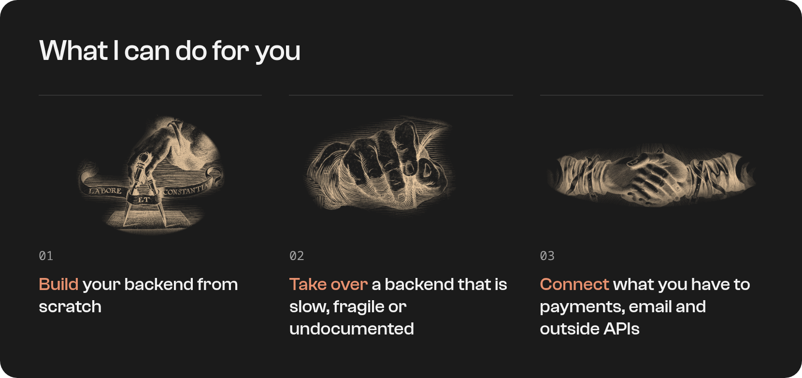
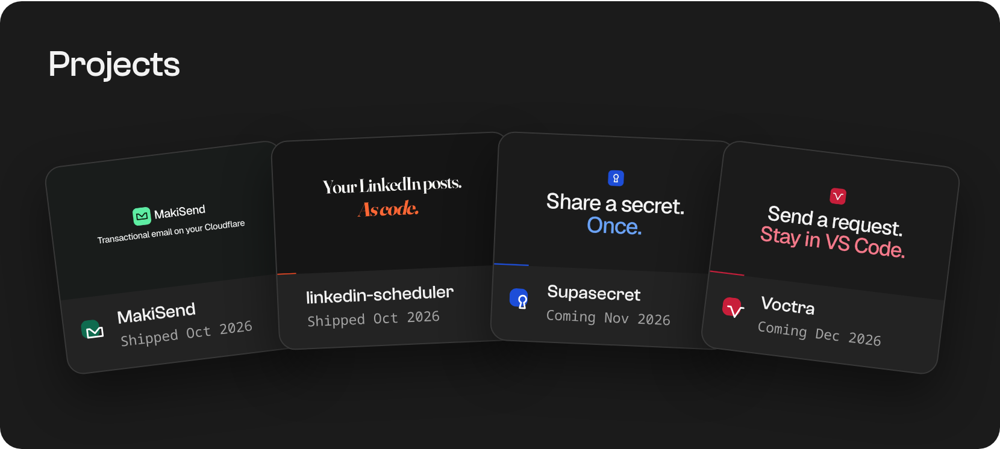

  <a href="https://joelcodja.pages.dev"><b>Portfolio</b></a>
  &nbsp;·&nbsp;
  <a href="https://joelcodja.pages.dev/blog/">Writing</a>
  &nbsp;·&nbsp;
  <a href="https://www.linkedin.com/in/joel-codja-4356a2361/">LinkedIn</a>
  &nbsp;·&nbsp;
  <a href="https://x.com/Gide749Gide">X</a>
  &nbsp;·&nbsp;
  <a href="mailto:gide749@gmail.com">gide749@gmail.com</a>

 

I build backends at [Lixali Studio](https://lixalistudio.tech): developer-facing APIs, event-driven systems and serverless infrastructure deployed at the edge.

 

**Open to freelance work.** Tell me what you have and where it hurts: [gide749@gmail.com](mailto:gide749@gmail.com).

 

**[MakiSend](https://makisend.lixalistudio.tech)** &nbsp;·&nbsp; Open-source transactional email that runs on your own Cloudflare account. [Code](https://github.com/lixalistudio-oss/makisend)

**[linkedin-scheduler](https://linkedin-scheduler.makisend-poc.workers.dev)** &nbsp;·&nbsp; Write LinkedIn posts in advance as Markdown files and let cron publish them through LinkedIn's official API. [Code](https://github.com/cjdotdev/linkedin-scheduler)

**Supasecret** &nbsp;·&nbsp; Coming Nov 2026. Share secrets through one-time links, encrypted in the browser so the server never reads them.

**Voctra** &nbsp;·&nbsp; Coming Dec 2026. A VS Code extension to send HTTP requests, read responses and save them in collections, without leaving the editor.

 

### The tools I use

**Languages** &nbsp; TypeScript · SQL · Python 
**APIs** &nbsp; Hono · Node.js · REST · OpenAPI · Scalar · Zod 
**Cloud and data** &nbsp; Cloudflare Workers · D1 · Queues · Workflows · Drizzle · SQLite · PostgreSQL 
**Quality and delivery** &nbsp; Vitest · GitHub Actions · Docker

 

